# Software Requirements Specification (SRS) dan Arsitektur Sistem
## DompetKu: Aplikasi Manajemen Keuangan Personal Berbasis Web

| | |
|---|---|
| **Mata kuliah** | Pemrograman Web (4 SKS) |
| **Program studi / semester** | Sarjana Terapan Manajemen Informatika / 3 |
| **Institusi** | Fakultas Vokasi, Universitas Negeri Surabaya (UNESA) |
| **Dosen pengampu** | Ari Kurniawan, S.Kom., M.T. dan Faris Abdi El Hakim, S.Kom., M.Tr.Kom. |
| **Kelompok** | Kelompok 5, kelas 2025D |
| **Penyusun** | Firdaus Hidayat (25091397149), Fakhrizatus Juva Leizikha (25091397142), Andy Yusuf Maulana (25091397150) |
| **Jenis tugas** | UTS: membuat halaman website interaktif dengan HTML, CSS, dan JavaScript, lalu di-hosting di GitHub |
| **Versi dokumen** | 1.0 |
| **Alamat web** | https://firdaushidayat015-beep.github.io/Dompetku/dompetku/dompetku/ |

---

## 1. Pendahuluan

### 1.1 Tujuan dokumen
Dokumen ini menjabarkan kebutuhan fungsional dan nonfungsional, perilaku sistem, data, serta arsitektur DompetKu agar dapat dijadikan acuan pengembangan, pengujian, dan penilaian tugas UTS Pemrograman Web.

### 1.2 Tujuan produk
DompetKu membantu pengguna mencatat arus kas, memantau anggaran bulanan, merencanakan target tabungan, dan menganalisis laporan keuangan melalui antarmuka web yang interaktif.

### 1.3 Lingkup
- Aplikasi berjalan **sepenuhnya di sisi klien** (browser). Tidak ada server aplikasi, basis data, maupun API eksternal.
- Data awal (data contoh) tertanam di `js/data.js`. Seluruh perubahan pengguna disimpan di `localStorage` browser dengan kunci `dompetku-state-v4`.
- Aplikasi dihosting sebagai situs statis di GitHub Pages.
- Tanggal demo ditetapkan pada **Oktober 2026**. Nilai tukar mata uang dan beberapa angka pendukung bersifat simulasi.

**Di luar lingkup:** autentikasi, sinkronisasi antarperangkat, koneksi ke bank sungguhan, notifikasi push sungguhan, dan penyimpanan di server.

### 1.4 Definisi dan singkatan

| Istilah | Arti |
|---|---|
| SPA | Single Page Application: satu `index.html`, perpindahan halaman tanpa reload |
| State | Objek JavaScript `state` berisi profil, pengaturan, kategori, rekening, transaksi, dan target |
| Seed | Data contoh awal (`SEED_STATE` di `data.js`, salinannya di `data/seed.json`) |
| Modal | Jendela form dialog tunggal yang dipakai bersama oleh semua form |
| Toast | Notifikasi singkat yang muncul lalu hilang otomatis |
| Pagu | Batas anggaran bulanan (`settings.budget`) |

### 1.5 Pengguna dan aktor

| Aktor | Deskripsi |
|---|---|
| Pengguna | Satu-satunya aktor. Mengakses semua fitur tanpa login. |

### 1.6 Lingkungan operasi
- Browser modern (Chrome, Edge, Firefox, Safari versi terbaru) dengan JavaScript dan `localStorage` aktif.
- Desktop, tablet, dan ponsel.
- Memerlukan internet untuk memuat font **Plus Jakarta Sans** dan ikon **Material Symbols** dari Google Fonts. Tanpa internet, aplikasi tetap berfungsi dengan font dan ikon cadangan browser.

### 1.7 Keterkaitan dengan ketentuan UTS
Lihat bagian 10 untuk pemetaan lengkap ke instruksi dan kriteria penilaian UTS.

---

## 2. Gambaran Umum Sistem

### 2.1 Perspektif produk
DompetKu adalah aplikasi mandiri (standalone) tanpa dependensi framework. Teknologi yang dipakai: **HTML5, CSS3, dan JavaScript ES6+ murni**.

### 2.2 Fungsi utama
1. Ringkasan keuangan (Beranda).
2. Pencatatan dan pencarian transaksi (Transaksi).
3. Perencanaan target tabungan (Target Tabungan).
4. Analisis visual pengeluaran (Laporan Keuangan).
5. Pengelolaan preferensi dan akun (Pengaturan).
6. Pergantian tema terang dan gelap.

### 2.3 Karakteristik pengguna
Pengguna umum yang terbiasa memakai browser. Tidak diperlukan keahlian teknis.

### 2.4 Batasan
- Kapasitas data dibatasi kuota `localStorage` browser (sekitar 5 MB).
- Data hanya ada di browser dan perangkat yang dipakai. Menghapus data situs browser menghapus data aplikasi.
- Mode privat/incognito dapat membuat penyimpanan tidak bertahan. Aplikasi tetap berjalan karena kegagalan penyimpanan ditangani dengan `try/catch`.

### 2.5 Asumsi dan dependensi
- Browser mendukung `localStorage`, `structuredClone`, CSS Grid, Flexbox, dan CSS Variables.
- Layanan Google Fonts tersedia untuk tampilan font dan ikon yang optimal.

---

## 3. Kebutuhan Fungsional

| Kode | Kebutuhan | Halaman | Prioritas |
|---|---|---|---|
| F-01 | Sistem menampilkan ringkasan: total saldo aktif, pemasukan, pengeluaran, sisa anggaran dan daya belanja harian, donut alokasi pengeluaran, target impian utama, dan 4 transaksi terbaru. Semua angka dihitung dari data transaksi. | Beranda | Tinggi |
| F-02 | Pengguna dapat mencatat transaksi (pemasukan atau pengeluaran) melalui form modal: nominal, judul, catatan opsional, kategori, metode pembayaran, tanggal. | Transaksi | Tinggi |
| F-03 | Sistem memvalidasi form transaksi: nominal wajib dan harus angka lebih dari 0, judul wajib, tanggal wajib. Pesan kesalahan merah tampil di bawah field yang salah. | Transaksi | Tinggi |
| F-04 | Pengguna dapat memfilter transaksi menurut jenis (Semua/Pengeluaran/Pemasukan), metode pembayaran, kategori, dan kata kunci (pencarian di halaman dan di topbar), dengan paginasi 7 baris per halaman. | Transaksi | Tinggi |
| F-05 | Pengguna dapat menghapus transaksi setelah konfirmasi. | Transaksi | Sedang |
| F-06 | Pengguna dapat membuat target tabungan baru (nama, kategori, jumlah target, terkumpul awal, estimasi bulan). Sistem menghitung saran setoran per bulan secara otomatis saat form diisi. | Target Tabungan | Tinggi |
| F-07 | Pengguna dapat menambah setoran ke target, mengarsipkan atau mengaktifkan kembali, menghapus, dan menjadikan target sebagai target utama. Target yang mencapai jumlah sasaran berstatus Selesai. Daftar target dibagi tab Sedang Berjalan, Selesai, dan Arsip. | Target Tabungan | Tinggi |
| F-08 | Sistem menampilkan donut proporsi pengeluaran per kategori, tren perbandingan bulan ke bulan, dan analisis metode pembayaran, dengan pilihan rentang **Bulan Ini** atau **Tahun 2026**. | Laporan | Sedang |
| F-09 | Pengguna dapat mengubah mata uang tampilan (IDR/USD/EUR), batas anggaran bulanan, kategori (tambah/hapus), profil (nama dan email), menambah rekening, menyembunyikan saldo di Beranda, dan mengatur preferensi notifikasi. | Pengaturan | Sedang |
| F-10 | Sistem memuat data dari `localStorage` bila ada, atau dari data contoh bila belum ada, dan menyimpan setiap perubahan secara langsung ke `localStorage`. | Semua | Tinggi |
| F-11 | Pengguna dapat mengganti tema Dark Mode / Light Mode kapan saja lewat tombol di topbar. Pilihan tema tersimpan dan dipakai saat halaman dimuat ulang. | Semua | Sedang |
| F-12 | Sistem menyediakan navigasi lima menu berbasis `#hash` (`#beranda`, `#transaksi`, `#tabungan`, `#laporan`, `#pengaturan`) tanpa reload halaman. Alamat tidak dikenal diarahkan ke Beranda. | Semua | Tinggi |
| F-13 | Pengguna dapat mengembalikan seluruh data ke data contoh awal setelah konfirmasi. | Pengaturan | Rendah |
| F-14 | Pengguna dapat menyalin ID pengguna ke clipboard. | Pengaturan | Rendah |
| F-15 | Sistem menampilkan toast sebagai umpan balik setiap aksi berhasil, dan menutup modal dengan tombol Batal, tombol Tutup, klik area gelap, atau tombol Esc. | Semua | Sedang |

**Catatan fungsi simulasi:** toggle notifikasi (harian, batas anggaran, mingguan) hanya menyimpan preferensi, dan tombol "Kelola izin & batas auto-debit" hanya menampilkan toast. Keduanya tidak mengirim notifikasi atau menghubungi bank sungguhan.

### 3.1 Aturan bisnis dan rumus perhitungan

| Besaran | Rumus |
|---|---|
| Total pemasukan / pengeluaran | Jumlah nominal transaksi berjenis `in` / `out` |
| Surplus arus kas (Sisa Anggaran Aman) | Total pemasukan dikurangi total pengeluaran |
| Total saldo aktif | `SALDO_AWAL` (Rp 10.000.000.000) ditambah total pemasukan dikurangi total pengeluaran |
| Pagu pemakaian | Total pengeluaran dibagi total pemasukan dikali 100% |
| Daya belanja harian | `max(0, surplus)` dibagi `SISA_HARI_SIKLUS` (11 hari) |
| Persentase target tercapai | Terkumpul dibagi sasaran dikali 100% |
| Saran setoran per bulan | `ceil((target dikurangi terkumpul awal) / jumlah bulan sampai estimasi)`, dihitung dari bulan acuan Oktober 2026 |
| Efisiensi anggaran (bulan ini) | Pengeluaran September 2026 dikurangi pengeluaran bulan berjalan: positif disebut **Hemat**, negatif **Boros** |
| Setoran ke target | `min(setoran, target dikurangi terkumpul)`: tidak melebihi sasaran |
| Konversi mata uang (simulasi) | USD = Rp dibagi 15.600; EUR = Rp dibagi 16.900 |

---

## 4. Kebutuhan Nonfungsional

| Kode | Kategori | Kebutuhan |
|---|---|---|
| NF-01 | Responsif | Tampilan menyesuaikan desktop, tablet, dan ponsel. Breakpoint 1100 px (grid 4 kolom menjadi 2 kolom, layout 2 kolom menjadi 1) dan 860 px (sidebar menjadi menu horizontal). |
| NF-02 | Standar | Kode HTML5 dan CSS3 mengikuti standar W3C dan diverifikasi dengan W3C Markup Validator dan CSS Validator. |
| NF-03 | Aksesibilitas | `lang="id"`, label form terhubung ke input (`for`/`id`), modal memakai `role="dialog"`, `aria-modal`, `aria-labelledby`; tombol ikon memakai `aria-label`; toast memakai `aria-live="polite"`; fokus terlihat (`:focus-visible`); animasi dinonaktifkan pada `prefers-reduced-motion`. |
| NF-04 | Kinerja | Seluruh pembaruan UI terjadi di sisi klien tanpa reload halaman (pendekatan SPA). |
| NF-05 | Keterbacaan kode | HTML, CSS, JavaScript, dan data dipisah dalam file masing-masing; komentar berbahasa Indonesia. |
| NF-06 | Keamanan sisi klien | Teks dari pengguna disaring dengan fungsi `esc()` sebelum disisipkan ke HTML untuk mencegah injeksi markup. Input angka dibersihkan dengan `parseMoney()`. |
| NF-07 | Keandalan data | Kegagalan `localStorage` (mode privat atau kuota penuh) ditangani dengan `try/catch` sehingga aplikasi tidak berhenti. Kunci penyimpanan berversi (`v4`) agar data lama yang tidak kompatibel diabaikan. |
| NF-08 | Kompatibilitas | Browser modern pada Windows, macOS, Linux, Android, dan iOS. |
| NF-09 | Lokalisasi | Antarmuka berbahasa Indonesia; format angka `id-ID` (titik ribuan, koma desimal); zona waktu ditampilkan WIB. |
| NF-10 | Kemudahan pemeliharaan | Seluruh konstanta (saldo awal, target pemasukan, warna kategori, daftar rekening, kurs) dikumpulkan di `data.js`. |
| NF-11 | Portabilitas | Dapat dibuka lokal dengan `index.html` tanpa server, dan di-host statis di GitHub Pages. |

---

## 5. Arsitektur Sistem

### 5.1 Gaya arsitektur
DompetKu memakai arsitektur **client-side, single page, berlapis (layered)** dengan pola **state terpusat + render ulang** (state-driven rendering):

1. **Lapisan Presentasi (View):** `index.html` (kerangka) dan `css/style.css` (tampilan).
2. **Lapisan Kontrol (Controller):** `js/app.js` (routing, event handler, validasi form, fungsi render).
3. **Lapisan Data dan Logika Domain (Model):** `js/data.js` (state, konstanta, penyimpanan, perhitungan ringkasan, pemformatan).
4. **Lapisan Penyimpanan:** `localStorage` browser.
5. **Lapisan Hosting:** GitHub Pages (file statis).

### 5.2 Diagram konteks dan komponen

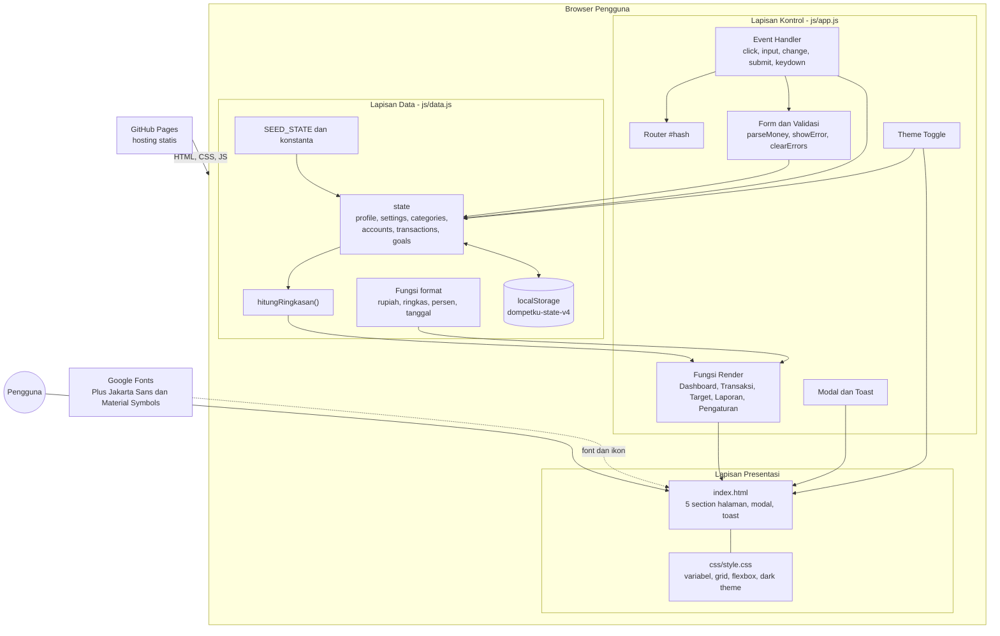

### 5.3 Tanggung jawab tiap komponen

| Komponen | File | Tanggung jawab |
|---|---|---|
| Kerangka halaman | `index.html` | Sidebar navigasi, topbar (pencarian global, periode, tombol tema, nama pengguna), 5 `<section class="page">`, modal tunggal, elemen toast; memuat `data.js` lalu `app.js` |
| Tampilan | `css/style.css` | Variabel warna (`:root`), tema gelap (`body.dark-theme`), Grid dan Flexbox, kartu, tabel, toggle switch, donut, progress bar, modal, toast, animasi, media query |
| Data dan domain | `js/data.js` | Konstanta (`STORAGE_KEY`, `SALDO_AWAL`, `TARGET_PEMASUKAN`, `SISA_HARI_SIKLUS`, `HARI_INI`), data contoh (transaksi, target, rekening, kategori), `loadState()`, `saveState()`, `hitungRingkasan()`, fungsi format (`rupiah`, `ringkas`, `persen`, `tanggalPendek`, dll.), peta warna dan ikon kategori |
| Kontrol dan render | `js/app.js` | Helper DOM (`$`, `$$`, `esc`, `setText`, `setHTML`), `route()`, `renderAll()` dan render per halaman, pembuat form (`openTransactionForm`, `openGoalForm`, `openGoalDetail`, dll.), validasi, pendaftaran event listener, tema |
| Data awal (referensi) | `data/seed.json` | Salinan data contoh dalam format JSON untuk dokumentasi dan referensi. Aplikasi saat ini tidak membacanya saat berjalan (data awal diambil dari `SEED_STATE`). |
| Dokumentasi | `docs/`, `README.md` | SRS, dokumentasi perancangan (PDF), dan panduan penggunaan |

### 5.4 Arsitektur data (struktur `state`)

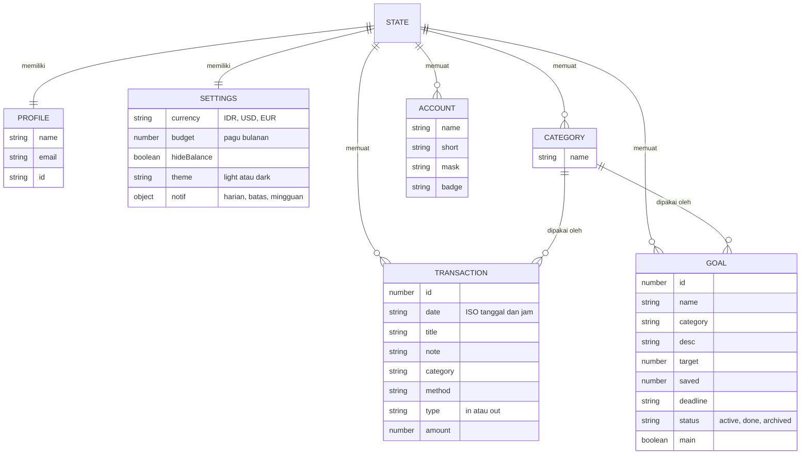

Selain itu, `state.growthThisMonth` menyimpan total setoran tabungan bulan berjalan. Data tahunan Januari sampai September 2026 untuk laporan "Tahun 2026" disimpan sebagai konstanta `DATA_TAHUNAN` (pemasukan, pengeluaran, kategori) di `data.js`.

### 5.5 Arsitektur alur data (state-driven rendering)

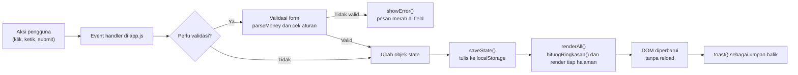

### 5.6 Diagram urutan: mencatat transaksi

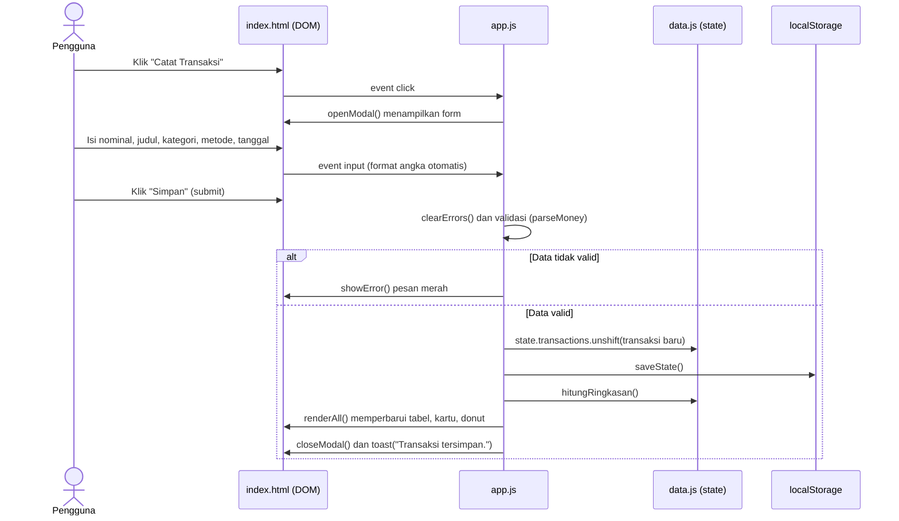

### 5.7 Arsitektur navigasi

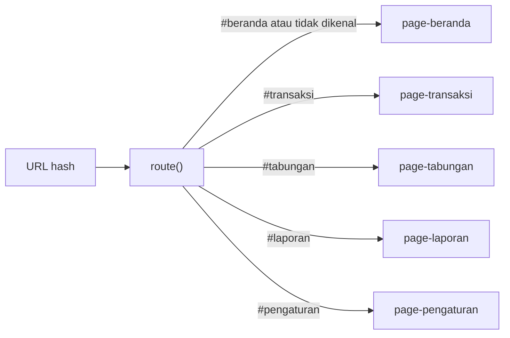

Peristiwa `hashchange` memanggil `route()`, yang menambahkan kelas `active` pada section yang sesuai dan pada menu sidebar, lalu menggulir halaman ke atas.

### 5.8 Arsitektur penerapan (deployment)

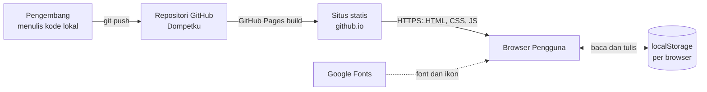

### 5.9 Struktur direktori

```text
Dompetku/
└── dompetku/
    ├── index.html
    ├── css/
    │   └── style.css
    ├── js/
    │   ├── data.js
    │   └── app.js
    ├── data/
    │   └── seed.json
    ├── docs/
    │   ├── SRS.md
    │   └── Dokumentasi_Perancangan_Sistem_DompetKu.pdf
    └── README.md
```

### 5.10 Keputusan arsitektur

| Keputusan | Alasan |
|---|---|
| Tanpa framework dan tanpa build tool | Sesuai tujuan UTS (menguji HTML, CSS, JavaScript dasar) dan mudah di-hosting statis |
| Satu `index.html` dengan routing `#hash` | Perpindahan halaman cepat tanpa reload; berjalan di GitHub Pages tanpa konfigurasi server |
| State terpusat dan `renderAll()` | Tampilan selalu konsisten dengan data; logika render mudah diikuti |
| Data disimpan di `localStorage` | Tidak perlu backend; data tidak hilang saat refresh |
| Data awal tertanam di `data.js` | Menghindari kegagalan pemuatan berkas saat dibuka langsung dari `file://` dan masalah CORS |
| Grafik donut memakai SVG `<circle>` + `stroke-dasharray` | Tanpa pustaka grafik eksternal |
| Satu modal bersama untuk semua form | Mengurangi duplikasi markup dan perilaku |
| Event delegation pada `document` | Elemen yang dibuat dinamis tetap dapat diklik tanpa memasang ulang listener |

---

## 6. Model Use Case

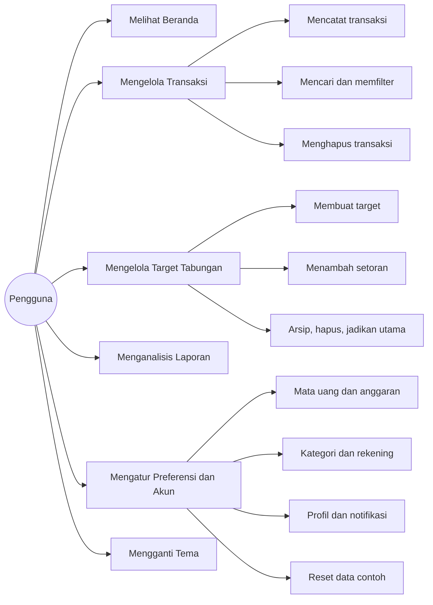

| Use Case | Deskripsi | Kebutuhan terkait |
|---|---|---|
| Melihat Beranda | Melihat ringkasan saldo, pemasukan, pengeluaran, sisa anggaran, alokasi, target utama, dan transaksi terbaru | F-01 |
| Mengelola Transaksi | Mencatat, mencari, memfilter, dan menghapus transaksi | F-02 sampai F-05 |
| Mengelola Target Tabungan | Membuat target (contoh: Maclaren, HJ 2027, Harley Davidson), menyetor, mengarsipkan, menghapus, menetapkan target utama | F-06, F-07 |
| Menganalisis Laporan | Melihat grafik proporsi pengeluaran, tren bulanan, dan metode pembayaran, bulan ini atau tahun 2026 | F-08 |
| Mengatur Preferensi dan Akun | Mengubah mata uang, anggaran, kategori, profil, rekening, notifikasi, privasi saldo, dan reset | F-09, F-13, F-14 |
| Mengganti Tema | Beralih antara mode terang dan gelap | F-11 |

### 6.1 Spesifikasi use case utama

**UC-02: Mencatat Transaksi**

| Elemen | Isi |
|---|---|
| Aktor | Pengguna |
| Prasyarat | Aplikasi telah dimuat |
| Pemicu | Pengguna menekan tombol "Catat Transaksi" |
| Alur utama | 1) Modal form tampil. 2) Pengguna memilih jenis, mengisi nominal, judul, catatan, kategori, metode, tanggal. 3) Pengguna menekan Simpan. 4) Sistem memvalidasi. 5) Sistem menambah transaksi, menyimpan, memperbarui seluruh tampilan, menutup modal, dan menampilkan toast. |
| Alur alternatif | Validasi gagal: pesan merah tampil di field bermasalah dan modal tetap terbuka. Batal/Esc/klik area gelap: modal ditutup tanpa perubahan. |
| Pascakondisi | Transaksi tersimpan di `state` dan `localStorage`; filter dikembalikan ke "Semua" |

**UC-03: Membuat Target Tabungan**

| Elemen | Isi |
|---|---|
| Aktor | Pengguna |
| Pemicu | Pengguna menekan "Buat Target Baru" |
| Alur utama | 1) Form tampil. 2) Pengguna mengisi nama, kategori, jumlah target, terkumpul awal (opsional), estimasi bulan. 3) Sistem menampilkan saran setoran per bulan secara langsung. 4) Pengguna menekan "Simpan target". 5) Sistem memvalidasi, membuat target berstatus `active`, menyimpan, dan merender ulang kartu serta total tabungan. |
| Alur alternatif | Validasi gagal: nama kosong, target kosong atau tidak valid, terkumpul awal tidak lebih kecil dari target, estimasi bulan kosong atau sebelum November 2026. |

---

## 7. Alur Kerja dan Activity Diagram

### 7.1 Alur kerja umum

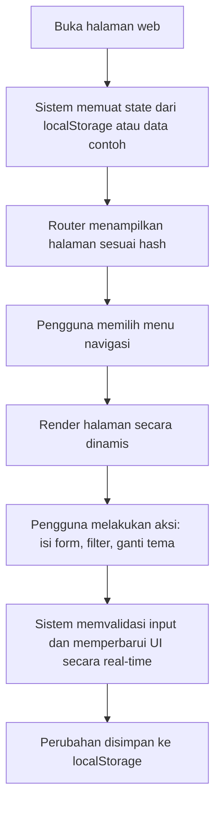

### 7.2 Activity diagram: mencatat transaksi baru

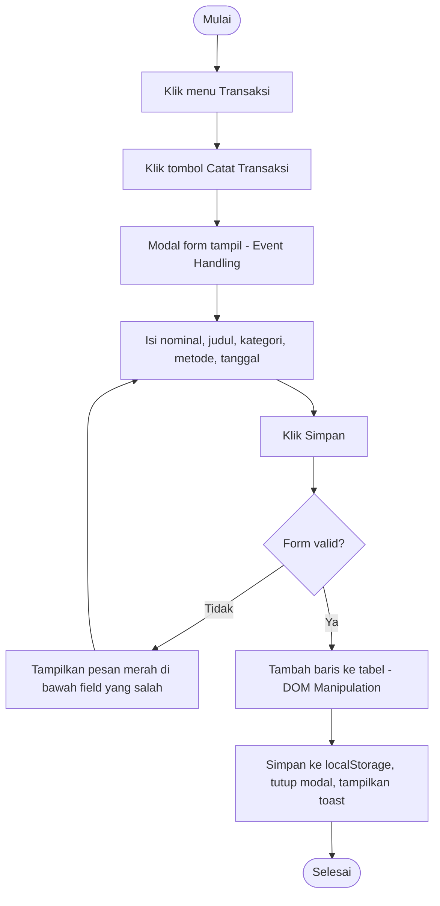

### 7.3 Activity diagram: membuat target tabungan

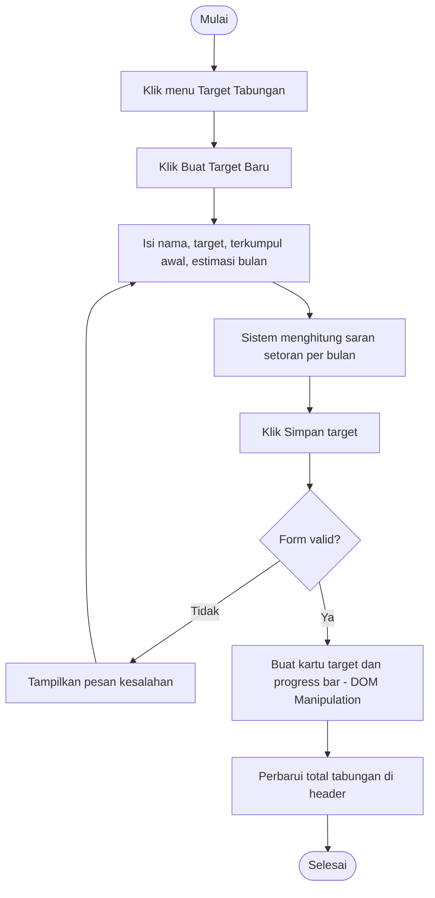

### 7.4 Activity diagram: menambah setoran ke target

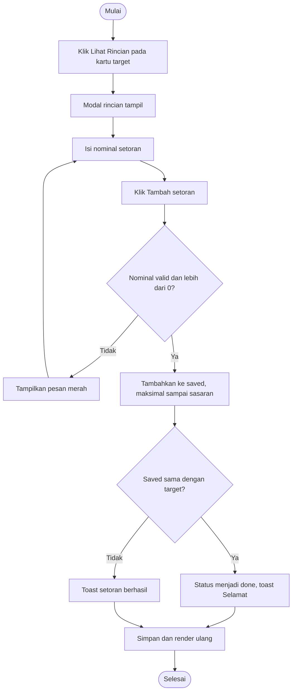

### 7.5 Activity diagram: mengganti tema

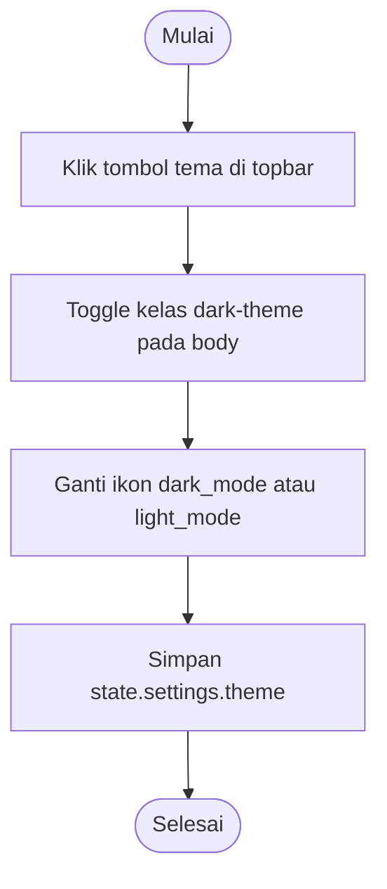

---

## 8. Spesifikasi Antarmuka

### 8.1 Antarmuka pengguna

| Halaman | Isi utama |
|---|---|
| **Beranda** | Chip periode, sapaan; 4 kartu statistik (saldo, pemasukan, pengeluaran, sisa anggaran) dengan progress bar; donut alokasi pengeluaran dan legenda; kartu target impian utama; daftar 4 transaksi terbaru |
| **Transaksi** | Tiga kartu ringkasan (pemasukan, pengeluaran, surplus); tab jenis dengan jumlah; chip metode; kolom pencarian; filter kategori; tabel (tanggal dan waktu, deskripsi, kategori, rekening/dompet, jenis, nominal, aksi hapus); paginasi |
| **Target Tabungan** | Kartu ringkasan total tabungan (terkumpul, kekurangan, pertumbuhan bulan ini, target terdekat); tab Sedang Berjalan / Selesai / Arsip; kartu target dengan progress bar |
| **Laporan Keuangan** | Toggle Bulan Ini / Tahun 2026; kartu pemasukan, pengeluaran, efisiensi; donut kategori dan legenda; bar distribusi beban anggaran; tren komparasi bulan ke bulan; daftar metode pembayaran |
| **Pengaturan** | Profil dan tombol edit; rekening terkait dan tambah; mata uang; batas anggaran; kategori; sembunyikan saldo; tiga toggle notifikasi; tombol kembalikan data contoh |
| **Komponen global** | Sidebar navigasi, topbar (pencarian global, periode, tombol tema, nama pengguna), modal form, toast |

### 8.2 Antarmuka perangkat keras
Tidak ada. Perangkat input: papan ketik, mouse, atau layar sentuh.

### 8.3 Antarmuka perangkat lunak
- API peramban: DOM, `localStorage`, `Clipboard API` (`navigator.clipboard`), `Intl`/`toLocaleString("id-ID")`, `structuredClone`.
- Layanan eksternal: Google Fonts (tampilan saja).
- Tidak ada permintaan jaringan lain saat aplikasi dijalankan.

### 8.4 Daftar pesan kesalahan validasi

| Form | Kondisi | Pesan |
|---|---|---|
| Transaksi | Nominal kosong | "Nominal wajib diisi." |
| Transaksi | Nominal bukan angka | "Gunakan angka saja, contoh: 150.000" |
| Transaksi | Nominal 0 atau kurang | "Nominal harus lebih dari 0." |
| Transaksi | Judul kosong | "Judul transaksi wajib diisi." |
| Transaksi | Tanggal kosong | "Tanggal wajib diisi." |
| Target baru | Nama kosong | "Nama target wajib diisi." |
| Target baru | Jumlah target kosong atau tidak valid | "Jumlah target wajib diisi." / "Isi dengan angka lebih dari 0." |
| Target baru | Terkumpul awal tidak lebih kecil dari target | "Harus lebih kecil dari jumlah target." |
| Target baru | Estimasi bulan kosong atau sebelum 2026-11 | "Pilih estimasi bulan tercapai." / "Pilih bulan setelah Oktober 2026." |
| Setoran | Nominal kosong atau tidak valid | "Isi nominal setoran." / "Gunakan angka valid lebih dari 0." |
| Anggaran | Nilai tidak valid | "Isi dengan angka lebih dari 0." |
| Kategori | Nama kosong, duplikat, atau masih dipakai transaksi | "Nama kategori wajib diisi." / "Kategori itu sudah ada." / pesan kategori masih dipakai |
| Profil | Nama kosong atau email tidak valid | "Nama wajib diisi." / "Format email belum benar." |
| Rekening | Nama kosong atau digit bukan 4 angka | "Nama rekening wajib diisi." / "Isi tepat 4 angka." |

---

## 9. Data Awal (Data Contoh)

| Entitas | Isi |
|---|---|
| Profil | Firdaus Hidayat S.,Tr.,Kom., email contoh, ID `FH-2026-KOM` |
| Pengaturan | Mata uang IDR, anggaran Rp 10.000.000/bulan, saldo tampil, tiga notifikasi aktif |
| Kategori (9) | Makanan & Minuman, Tempat Tinggal & Utilitas, Belanja & Kebutuhan, Transportasi, Hiburan, Gaji & Karier, Bonus / Hadiah, Kendaraan Impian, Ibadah |
| Rekening (3) | Tahapan BCA (Utama), Mandiri Tabungan, GoPay & OVO |
| Transaksi (16) | Transaksi Oktober 2026: 2 pemasukan (gaji dan cashback) dan 14 pengeluaran |
| Target (3) | **Maclaren** (utama, sasaran Rp 8 miliar, terkumpul Rp 1,5 miliar, tenggat 31 Des 2028), **HJ 2027** (sasaran Rp 350 juta, terkumpul Rp 200 juta, tenggat 15 Mei 2027), **Harley Davidson** (sasaran Rp 600 juta, terkumpul Rp 50 juta, tenggat 30 Jun 2028) |
| Konstanta | Saldo awal Rp 10.000.000.000; target pemasukan bulanan Rp 15.000.000; sisa hari siklus 11 |
| Data tahunan | Pemasukan dan pengeluaran Januari sampai September 2026 untuk laporan "Tahun 2026" |

---

## 10. Pemenuhan Kriteria UTS

### 10.1 Instruksi tugas

| Instruksi UTS | Implementasi di DompetKu |
|---|---|
| Halaman utama HTML | `index.html` memuat 5 halaman (section) yang ditampilkan lewat navigasi hash |
| Header dengan judul dan deskripsi singkat | Topbar aplikasi (`<header class="topbar">`), judul `<h1>` setiap halaman, dan deskripsi singkat (`<p class="muted">`) di bawah judul halaman. Beranda dan Transaksi memakai deskripsi dari perbaikan 4.3 pada `Analisis_UTS_DompetKu.md`. |
| Navigasi minimal dua pilihan | Menu sidebar dengan 5 pilihan: Beranda, Transaksi, Target Tabungan, Laporan Keuangan, Pengaturan |
| Konten informatif dengan teks dan desain CSS | Kartu ringkasan, tabel, donut, progress bar, legenda, ikon Material Symbols |
| Event Handling | `addEventListener` pada klik, `input`, `change`, `submit`, `keydown`, `hashchange`; event delegation |
| DOM Manipulation | Render tabel, kartu target, donut, dan legenda secara dinamis tanpa reload |
| Style & Animation | `transition` pada progress bar, `@keyframes pop` pada modal, toast fade, Dark Mode |
| Form Validation | Validasi nominal, judul, tanggal, email, digit rekening, kategori; pesan merah per field |
| AJAX | Tidak digunakan. Keputusan desain: data awal tertanam di `data.js` dan perubahan disimpan di `localStorage`, sehingga tidak ada permintaan jaringan dan aman saat dibuka langsung dari berkas lokal. |
| Desain CSS estetis dan mudah dibaca | Palet hijau, tipografi Plus Jakarta Sans, kartu, bayangan lembut, Dark Mode |
| Standar HTML dan CSS | HTML5 semantik dan CSS3; verifikasi dengan validator W3C |
| Hosting di GitHub | GitHub Pages; alamat tercantum pada README dan dokumen ini |

### 10.2 Bagian yang dinilai

| Kriteria (bobot) | Bukti |
|---|---|
| Struktur HTML (20) | Elemen semantik `aside`, `nav`, `header`, `main`, `section`, `article`, `table` (`thead`/`tbody`), `form`, `label`; atribut ARIA pada modal dan toast. Dijelaskan di README. |
| Desain CSS (30) | Variabel CSS, Grid, Flexbox, toggle switch murni CSS, donut SVG, tema gelap, responsif pada 1100 px dan 860 px. Dijelaskan di README. |
| Kreativitas dan Desain (20) | Aplikasi keuangan dengan donut, progress bar, glass chip, Dark Mode, toast, dan target tabungan interaktif |
| Dokumentasi dan SRS (30) | Dokumen ini, `Dokumentasi_Perancangan_Sistem_DompetKu.pdf`, dan README dengan penjelasan struktur, CSS, dan JavaScript |
| Fungsionalitas JavaScript (20) | Event handling, DOM manipulation, style dan animasi, validasi form, state dengan `localStorage` |

---

## 11. Rencana Pengujian Singkat

| ID | Skenario | Langkah | Hasil yang diharapkan |
|---|---|---|---|
| T-01 | Navigasi | Klik tiap menu sidebar | Halaman sesuai tampil, menu aktif ter-highlight, tanpa reload |
| T-02 | Validasi transaksi kosong | Buka form, klik Simpan tanpa mengisi | Pesan merah pada nominal, judul; modal tetap terbuka |
| T-03 | Validasi nominal salah | Isi nominal "abc" atau "0" | Pesan kesalahan sesuai |
| T-04 | Catat transaksi valid | Isi semua field, Simpan | Baris baru muncul, ringkasan berubah, toast tampil |
| T-05 | Filter dan pencarian | Pilih tab Pemasukan, ketik kata kunci, pilih kategori | Tabel hanya menampilkan data yang cocok; paginasi menyesuaikan |
| T-06 | Hapus transaksi | Klik ikon hapus, konfirmasi | Transaksi hilang dan ringkasan diperbarui |
| T-07 | Buat target | Isi form target dan estimasi bulan | Saran per bulan tampil; kartu target baru muncul |
| T-08 | Setoran melebihi sisa | Setor lebih besar dari sisa target | Saldo target tidak melebihi sasaran; status menjadi Selesai |
| T-09 | Persistensi | Tambah data lalu refresh halaman | Data tetap ada |
| T-10 | Dark Mode | Klik tombol tema, refresh | Tema gelap diterapkan dan bertahan |
| T-11 | Responsif | Perkecil lebar jendela di bawah 1100 px dan 860 px | Grid berubah dan sidebar menjadi menu horizontal |
| T-12 | Reset data | Pengaturan, Kembalikan data contoh | Data kembali ke data contoh setelah konfirmasi |
| T-13 | Mata uang | Ubah ke USD | Semua nominal tampil dalam USD hasil konversi simulasi |

---

## 12. Keterbatasan dan Pengembangan Lanjutan

**Keterbatasan saat ini**
- Data bersifat lokal per browser dan tidak tersinkron antarperangkat.
- Tanggal demo, nilai tukar, saldo awal, dan sebagian teks ringkasan (misalnya jumlah rekening di kartu saldo dan sisa hari siklus) bersifat simulasi.
- Notifikasi dan auto-debit hanya simulasi tampilan.
- Tidak ada autentikasi pengguna.

**Pengembangan lanjutan**
- Memuat data awal dari `data/seed.json` melalui `fetch` (AJAX) dengan cadangan `SEED_STATE`.
- Ekspor dan impor data (CSV/JSON).
- Backend dan basis data untuk sinkronisasi dan login.
- Font dan ikon lokal agar sepenuhnya berjalan tanpa internet.
- Notifikasi sungguhan lewat Notification API.
