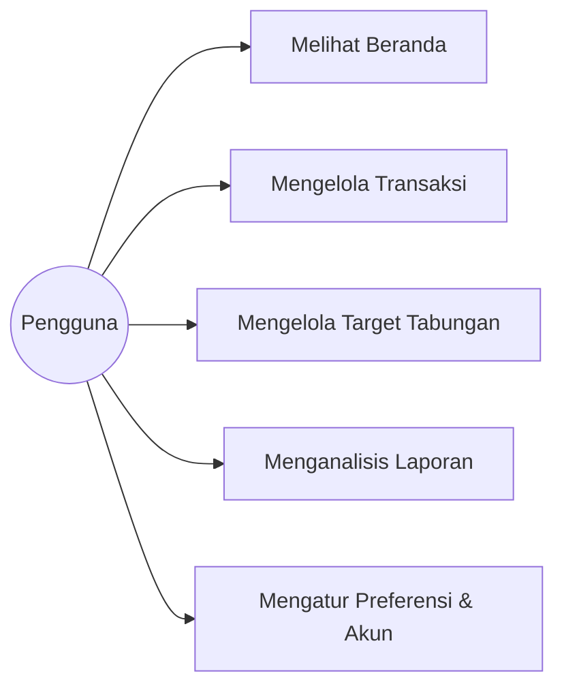
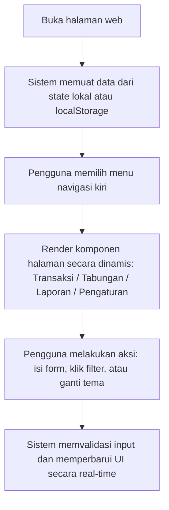
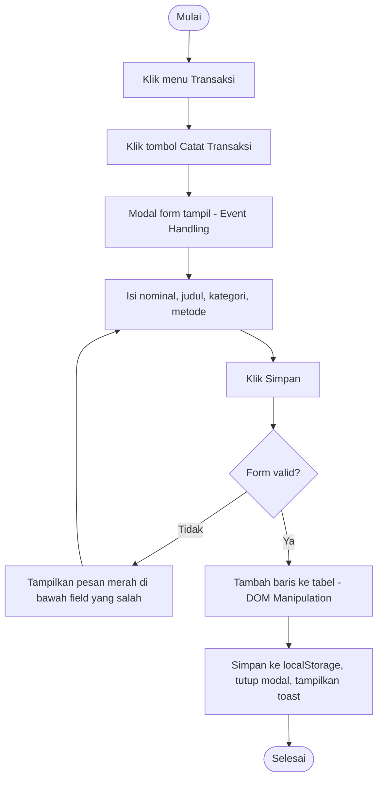

# SRS - DompetKu (Software Requirements Specification)

**Matakuliah:** Pemrograman Web (UTS) | **Penyusun:** Firdaus Hidayat S.,Tr.,Kom. (25091397149) | **Fokus:** antarmuka interaktif HTML, CSS, JavaScript

## 1. Pendahuluan
**Tujuan.** DompetKu adalah aplikasi web manajemen keuangan personal untuk mencatat arus kas, memantau anggaran, merencanakan target tabungan, dan menganalisis laporan bulanan.
**Lingkup.** Aplikasi beroperasi sepenuhnya di sisi klien (tanpa *backend*). Data awal dikelola melalui *state* JavaScript internal untuk mencegah error *fetching* saat di-hosting, dan seluruh perubahan yang dilakukan pengguna disimpan secara dinamis menggunakan `localStorage`.
**Aktor.** Satu aktor: Pengguna.
**Lingkungan.** Browser modern (Chrome, Edge, Firefox), dihosting di GitHub Pages.

## 2. Kebutuhan Fungsional

| Kode | Kebutuhan | Halaman |
|---|---|---|
| F-01 | Sistem menampilkan ringkasan saldo, pemasukan, pengeluaran, sisa anggaran harian, alokasi pengeluaran, dan transaksi terbaru. | Beranda |
| F-02 | Pengguna dapat mencatat transaksi (pemasukan/pengeluaran) lewat form modal. | Transaksi |
| F-03 | Sistem memvalidasi form: nominal dan judul wajib diisi, nominal harus angka valid lebih dari 0. | Transaksi |
| F-04 | Pengguna dapat memfilter transaksi berdasarkan jenis, metode pembayaran, kategori, dan kata kunci, dengan paginasi. | Transaksi |
| F-05 | Pengguna dapat menghapus transaksi. | Transaksi |
| F-06 | Pengguna dapat membuat target tabungan baru; sistem menghitung saran alokasi per bulan secara otomatis. | Target Tabungan |
| F-07 | Pengguna dapat menambah setoran ke target, mengarsipkan, menghapus, dan menjadikan target sebagai prioritas utama. | Target Tabungan |
| F-08 | Sistem menampilkan grafik proporsi pengeluaran, perbandingan antarbulan, dan analisis metode pembayaran. | Laporan |
| F-09 | Pengguna dapat mengubah mata uang, batas anggaran, kategori, profil, rekening, dan preferensi notifikasi. | Pengaturan |
| F-10 | Sistem memuat data awal dari lokal dan menyimpan perubahan secara *real-time* ke `localStorage`. | Semua |
| F-11 | Pengguna dapat mengubah tema tampilan aplikasi (Dark Mode / Light Mode) kapan saja melalui tombol di *topbar*. | Semua |

## 3. Kebutuhan Non-Fungsional

| Kode | Kebutuhan |
|---|---|
| NF-01 | **Responsif:** tampilan menyesuaikan layar desktop, tablet, dan ponsel (breakpoint 1100px dan 860px). |
| NF-02 | **Standar:** HTML dan CSS lolos validasi standar pengembangan web modern tanpa *error*. |
| NF-03 | **Aksesibilitas:** atribut `alt`, label form, ARIA pada modal, dan dukungan `prefers-reduced-motion`. |
| NF-04 | **Kinerja:** perubahan UI diproses langsung di sisi klien tanpa *reload* halaman (pendekatan SPA). |
| NF-05 | **Keterbacaan kode:** struktur terpisah (HTML, CSS, JS, data lokal) dan komentar berbahasa Indonesia. |

## 4. Use Case

| Use Case | Deskripsi |
|---|---|
| Melihat Beranda | Melihat ringkasan saldo, pemasukan, pengeluaran, sisa anggaran, alokasi, dan transaksi terbaru. |
| Mengelola Transaksi | Mencatat transaksi baru, melihat riwayat, mencari dan memfilter, menghapus. |
| Mengelola Target Tabungan | Membuat target (Maclaren, HJ 2027, Harley), memperbarui progres setoran, memantau pencapaian. |
| Menganalisis Laporan | Melihat grafik proporsi pengeluaran, perbandingan bulan, dan metode pembayaran. |
| Mengatur Preferensi & Akun | Mengubah tema visual (Dark/Light mode), mata uang, batas anggaran, kategori, notifikasi, dan profil. |

## 5. Alur Kerja Sistem

## 6. Activity Diagram: Mencatat Transaksi Baru

## 7. Activity Diagram: Membuat Target Tabungan

## 8. Pemenuhan Kriteria UTS

| Kriteria | Implementasi |
|---|---|
| Struktur HTML | 5 halaman dirangkum dalam satu `index.html` dengan elemen semantik; header berisi judul dan deskripsi; menu navigasi 5 pilihan. |
| Desain CSS | Menerapkan *Grid* dan *Flexbox*, variabel CSS murni, *glassmorphism card*, tabel, elemen *toggle*, donut chart dari SVG, dan fitur tema gelap (*Dark Mode*). Bersifat responsif. |
| Event Handling | Klik tombol "Catat Transaksi", pergantian "Dark Mode", filter kategori (`change`), tab halaman, dan sistem paginasi. |
| DOM Manipulation | Baris tabel riwayat dan kartu target beserta angka pencapaiannya dibuat secara dinamis tanpa *reload*. |
| Style & Animation | Transisi efek *width* pada progress bar, animasi pop-up pada interaksi modal, dan *toast notification*. |
| Form Validation | Pembersihan karakter pada input angka (*parser* kebal terhadap perbedaan *browser*) dan menampilkan pesan merah bila nominal/judul kosong atau format salah. |
| Hosting & Link | GitHub Pages: [https://firdaushidayat015-beep.github.io/Dompetku/dompetku/dompetku/](https://firdaushidayat015-beep.github.io/Dompetku/dompetku/dompetku/) |
